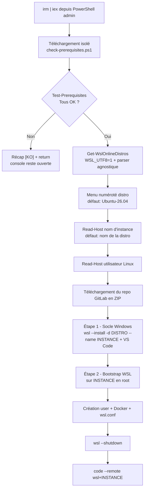
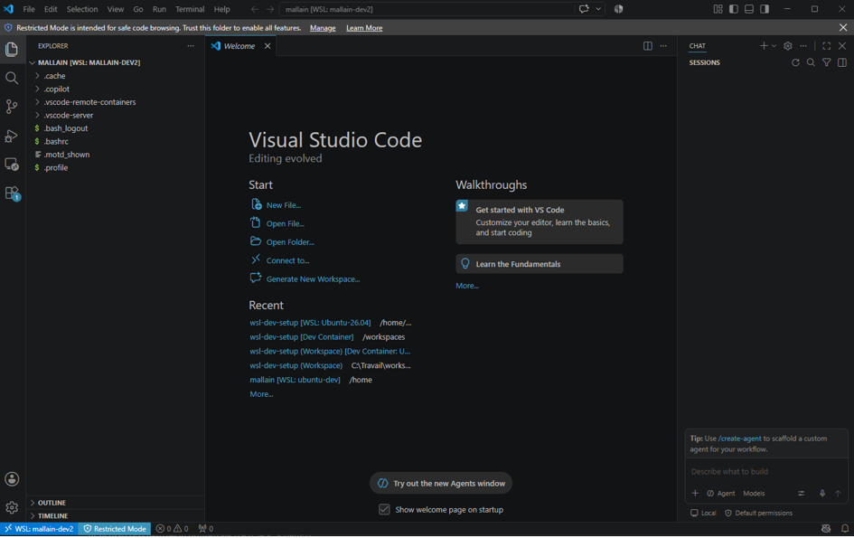

# wsl-dev-setup

> Provisionne en **une seule commande PowerShell** un poste de développement Windows complet : WSL 2 + Ubuntu, Visual Studio Code (avec Remote-WSL & Dev Containers), Docker CE dans WSL, et un utilisateur Linux prêt à l'emploi.


---

## Ce que fait ce script

En une commande, votre poste Windows est équipé de :

- WSL 2 activé avec la distribution **Ubuntu 26.04**
- **Visual Studio Code** installé via `winget`
- Extensions VS Code : `Remote - WSL` et `Dev Containers`
- Un **utilisateur Linux** avec `sudo` sans mot de passe (configurable)
- **Docker CE** (Engine + CLI + Buildx + Compose) installé dans WSL — **sans Docker Desktop**
- Configuration `/etc/wsl.conf` : démarrage `systemd` + utilisateur par défaut
- Lancement automatique de VS Code connecté en Remote-WSL sur le home de l'utilisateur

---

## Installation

### Prérequis

- **Windows 10 build 19041+ (version 2004 ou supérieure) ou Windows 11**
- **PowerShell 5.1+** (préinstallé sur Windows 10/11)
- **PowerShell lancé en tant qu'administrateur**
- **WSL 2.4.4+** (pour le support de `wsl --install --name`) — vérifiez avec `wsl --version`, mettez à jour avec `wsl --update`
- **winget** disponible (préinstallé sur Windows 11, sinon [App Installer](https://apps.microsoft.com/detail/9nblggh4nns1))
- Une connexion internet

> Le script vérifie automatiquement ces prérequis avant tout téléchargement lourd et affiche un récapitulatif clair en cas de problème.

### Commande unique

Dans une console **PowerShell administrateur** :

```powershell
irm https://gitlab.com/allain.mickael/wsl-dev-setup/-/raw/main/install.ps1 | iex
```

Le script vous demandera successivement :

1. La **distribution WSL** à installer (menu numéroté)
2. Le **nom d'instance** (par défaut identique au nom de la distro)
3. Le **nom d'utilisateur Linux** à créer

Puis il se charge du reste.

> **Premier setup WSL ?** Windows peut demander un redémarrage après l'activation de la fonctionnalité WSL. Dans ce cas, redémarrez puis relancez la même commande.

---

## Ce qui se passe étape par étape



---

## Aperçu de l'exécution

Les écrans ci-dessous montrent la cinématique complète du script, du lancement au VS Code prêt. Les sorties verbeuses (`apt-get update`, téléchargement de paquets, warnings Node.js) sont volontairement **résumées avec `[…]`** pour ne garder que les jalons signifiants.

### 1. Lancement & vérification des prérequis

<pre style="background:#1E1E1E;color:#DDDDDD;padding:12px;border-radius:6px;line-height:1.35;font-family:Consolas,'Courier New',monospace;">
<span style="color:#F1C40F">PS C:\WINDOWS\system32&gt;</span> irm https://gitlab.com/allain.mickael/wsl-dev-setup/-/raw/main/install.ps1 | iex
<span style="color:#00BCD4">==&gt; Téléchargement du script de vérification des prérequis...</span>

<span style="color:#00BCD4">=== Vérification des prérequis ===</span>
  <span style="color:#4EC94E">[OK]</span> Session administrateur                        OK
  <span style="color:#4EC94E">[OK]</span> PowerShell &gt;= 5.1                             Détecté : 5.1.26100.9168
  <span style="color:#4EC94E">[OK]</span> Windows build &gt;= 19041 (2004+)                Détecté : build 26100
  <span style="color:#4EC94E">[OK]</span> wsl.exe présent                               C:\WINDOWS\system32\wsl.exe
  <span style="color:#4EC94E">[OK]</span> WSL &gt;= 2.4.4 (support --name)                 Détecté : 2.7.14
  <span style="color:#4EC94E">[OK]</span> winget présent                                OK

<span style="color:#4EC94E">Tous les prérequis sont satisfaits.</span>
</pre>

### 2. Choix de la distribution & de l'instance

<pre style="background:#1E1E1E;color:#DDDDDD;padding:12px;border-radius:6px;line-height:1.35;font-family:Consolas,'Courier New',monospace;">
<span style="color:#00BCD4">==&gt; Récupération des distributions WSL disponibles...</span>

<span style="color:#F1C40F">Distributions disponibles (filtrées pour compatibilité apt — Ubuntu / Debian / Kali) :</span>
  [1] Ubuntu
  [2] Ubuntu-26.04 <span style="color:#F1C40F">(defaut)</span>
  [3] Ubuntu-24.04
  [4] Ubuntu-22.04
  [5] kali-linux
  [6] Debian
Numéro de la distribution <span style="color:#F1C40F">[2]</span>: <span style="color:#FFFFFF">↵</span>
<span style="color:#4EC94E">==&gt; Distribution sélectionnée : Ubuntu-26.04</span>
Nom de l'instance WSL <span style="color:#F1C40F">[Ubuntu-26.04]</span>: <span style="color:#FFFFFF">mallain-dev2</span>
<span style="color:#4EC94E">==&gt; Instance à créer : mallain-dev2 (source : Ubuntu-26.04)</span>
Entrez le nom d'utilisateur Linux souhaité (ex: mallain): <span style="color:#FFFFFF">mallain</span>
</pre>

### 3. Étapes 1–2 · Socle Windows (WSL + VS Code)

<pre style="background:#1E1E1E;color:#DDDDDD;padding:12px;border-radius:6px;line-height:1.35;font-family:Consolas,'Courier New',monospace;">
<span style="color:#00BCD4">==&gt; [1/5] Téléchargement des scripts...</span>
<span style="color:#00BCD4">==&gt; [2/5] Déploiement du socle Windows...</span>
Téléchargement : Ubuntu 26.04 LTS
Installation   : Ubuntu 26.04 LTS
La distribution a été installée. Elle peut être lancée via <span style="color:#F1C40F">'wsl.exe -d mallain-dev2'</span>

<span style="color:#888888">[…] winget : VS Code déjà à jour</span>
<span style="color:#888888">[…] Extensions VS Code : Remote-WSL + Dev Containers (déjà installées)</span>

<span style="color:#4EC94E">Socle Windows prêt.</span> Redémarre si WSL vient d'être activé pour la première fois.
</pre>

### 4. Étape 3 · Bootstrap Linux (user + Docker)

<pre style="background:#1E1E1E;color:#DDDDDD;padding:12px;border-radius:6px;line-height:1.35;font-family:Consolas,'Courier New',monospace;">
<span style="color:#00BCD4">==&gt; [3/5] Configuration interne de WSL via root...</span>
<span style="color:#00BCD4">==&gt; Initialisation de l'environnement pour l'utilisateur : mallain</span>
<span style="color:#00BCD4">==&gt; Création de l'utilisateur 'mallain'...</span>
<span style="color:#00BCD4">==&gt; Configuration du dépôt Docker officiel...</span>

<span style="color:#888888">[…] apt update  → 48 index sources rafraîchis (31.5 MB, 3 s)</span>
<span style="color:#888888">[…] apt upgrade → 12 paquets mis à jour (curl, gnupg, libcurl…)</span>

<span style="color:#00BCD4">==&gt; Installation de Docker CE...</span>

<span style="color:#888888">[…] 15 nouveaux paquets : containerd.io, docker-ce, docker-ce-cli,</span>
<span style="color:#888888">    docker-buildx-plugin, docker-compose-plugin, iptables, nftables… (101 MB)</span>
<span style="color:#888888">[…] systemd : containerd.service + docker.service activés</span>

<span style="color:#00BCD4">==&gt; Mise à jour de /etc/wsl.conf...</span>

<span style="color:#4EC94E">Terminé avec succès pour 'mallain'.</span>
Depuis PowerShell sous Windows, exécute : <span style="color:#F1C40F">wsl --shutdown</span>
</pre>

### 5. Étapes 4–5 · Redémarrage & lancement de VS Code

<pre style="background:#1E1E1E;color:#DDDDDD;padding:12px;border-radius:6px;line-height:1.35;font-family:Consolas,'Courier New',monospace;">
<span style="color:#00BCD4">==&gt; [4/5] Redémarrage de WSL...</span>
<span style="color:#00BCD4">==&gt; [5/5] Lancement de VS Code connecté à WSL...</span>

<span style="color:#4EC94E">Machine initialisée avec succès !</span>
</pre>

### 6. Résultat final · VS Code connecté en Remote-WSL

Quelques secondes plus tard, **VS Code s'ouvre automatiquement**, connecté à la nouvelle instance WSL, dans le home de l'utilisateur créé — prêt à coder :



> Le badge en bas à gauche affiche `WSL: mallain-dev2` et le terminal intégré est déjà positionné dans `/home/mallain` avec Docker fonctionnel.

### Variante · Un prérequis manquant

<pre style="background:#1E1E1E;color:#DDDDDD;padding:12px;border-radius:6px;line-height:1.35;font-family:Consolas,'Courier New',monospace;">
<span style="color:#00BCD4">=== Vérification des prérequis ===</span>
  <span style="color:#4EC94E">[OK]</span> Session administrateur                        OK
  <span style="color:#4EC94E">[OK]</span> PowerShell &gt;= 5.1                             Détecté : 5.1.26100.9168
  <span style="color:#4EC94E">[OK]</span> Windows build &gt;= 19041 (2004+)                Détecté : build 26100
  <span style="color:#4EC94E">[OK]</span> wsl.exe présent                               C:\WINDOWS\system32\wsl.exe
  <span style="color:#FF5555">[KO]</span> WSL &gt;= 2.4.4 (support --name)                 Détecté : 2.1.5 — <span style="color:#F1C40F">exécutez : wsl --update</span>
  <span style="color:#4EC94E">[OK]</span> winget présent                                OK

<span style="color:#FF5555">Certains prérequis ne sont pas satisfaits. Corrigez puis relancez la commande.</span>
<span style="color:#F1C40F">PS C:\WINDOWS\system32&gt;</span> _
</pre>

> Le script **s'arrête proprement** avant tout téléchargement lourd si un `[KO]` est détecté : la console reste ouverte avec le détail de l'action corrective.

---

## Structure du projet

```
wsl-dev-setup/
├── install.ps1                  # Point d'entrée (orchestrateur)
├── scripts/
│   ├── windows/
│   │   └── setup-dev.ps1        # Installe WSL + VS Code + extensions hôte
│   └── linux/
│       └── bootstrap.sh         # Provisionne l'utilisateur + Docker dans WSL
├── .devcontainer/               # Exemple de dev container
├── .vscode/                     # Réglages VS Code recommandés
└── README.md
```

---

## Configuration

Les principaux paramètres sont en tête de `install.ps1` :

| Variable         | Valeur par défaut  | Description                                                        |
|------------------|--------------------|--------------------------------------------------------------------|
| `$RepoZipUrl`    | archive GitLab     | URL du ZIP du repo à télécharger                                   |
| `$DistroName`    | *(choisi au menu)* | Distribution source WSL (menu filtré apt-compatibles)              |
| `$InstanceName`  | *(= `$DistroName`)*| Nom local de l'instance WSL (créée via `wsl --install --name`)     |
| `$TargetUser`    | *(demandé)*        | Nom de l'utilisateur Linux à créer                                 |

Le menu ne propose que les distributions Ubuntu, Debian et Kali. Le bootstrap Docker actuel utilise `apt` et ne fonctionne pas sur Fedora/openSUSE/Arch (voir roadmap).

---

## Sécurité

Exécuter `irm | iex` revient à **exécuter du code distant en administrateur**. Le flux télécharge en réalité **deux fichiers** depuis GitLab :

1. `install.ps1` (via `irm | iex`)
2. `scripts/windows/check-prerequisites.ps1` (téléchargé et exécuté par `install.ps1` en tout début, avant tout autre acte)

Prenez les précautions suivantes :

1. **Lisez les scripts** avant de les exécuter :
   ```powershell
   irm https://gitlab.com/allain.mickael/wsl-dev-setup/-/raw/main/install.ps1
   irm https://gitlab.com/allain.mickael/wsl-dev-setup/-/raw/main/scripts/windows/check-prerequisites.ps1
   ```
2. **Épinglez une version** plutôt que `main` pour vos déploiements :
   ```powershell
   irm https://gitlab.com/allain.mickael/wsl-dev-setup/-/raw/v1.0.0/install.ps1 | iex
   ```
3. Vérifiez les commits et le contenu de `scripts/linux/bootstrap.sh`, `scripts/windows/setup-dev.ps1` et `scripts/windows/check-prerequisites.ps1`.

> L'utilisateur Linux créé dispose de **`sudo` sans mot de passe** (`NOPASSWD`). C'est pratique pour un poste de dev personnel, mais **à éviter** sur une machine partagée ou exposée. Éditez `bootstrap.sh` si vous préférez un sudo classique.

---

## Vérifier l'installation

Après le premier lancement, dans un terminal WSL :

```bash
whoami                       # doit afficher votre utilisateur
sudo -n true && echo OK      # doit afficher OK
docker --version             # doit afficher la version Docker CE
docker compose version       # doit afficher la version Compose v2
systemctl is-system-running  # doit être "running" ou "degraded" (systemd actif)
```

Depuis PowerShell :

```powershell
wsl -l -v                    # doit lister Ubuntu-26.04 en version 2
code --version               # doit afficher la version VS Code
```

---

## Dépannage

| Problème | Solution |
|----------|----------|
| Un prérequis est marqué `[KO]` au démarrage | Suivez la commande ou le lien indiqué dans la colonne détail du récapitulatif, corrigez, puis relancez le one-liner. |
| `Le terme 'wsl' n'est pas reconnu` | Windows trop ancien. Mettre à jour vers 10 2004+ ou 11. |
| Le script se bloque sur `Read-Host` | Certains hôtes PowerShell ne gèrent pas bien `Read-Host` avec `iex`. Téléchargez le script et lancez-le en local : `iwr URL -OutFile install.ps1; .\install.ps1`. |
| Erreur après `wsl --install` | Redémarrer Windows puis relancer la commande. |
| `code` introuvable après installation | Fermez/rouvrez PowerShell, ou lancez : `& "$env:LOCALAPPDATA\Programs\Microsoft VS Code\bin\code.cmd" --version`. |
| Docker : `permission denied on /var/run/docker.sock` | Fermez WSL (`wsl --shutdown`), rouvrez une session : le groupe `docker` sera bien pris en compte. |
| systemd inactif | Vérifiez `/etc/wsl.conf` puis `wsl --shutdown` et relancez la distro. |
| Installation partielle (bootstrap tombé en erreur) | Supprimez l'instance créée : `wsl --unregister <nom_instance>`, puis relancez le one-liner en donnant un nom d'instance frais. Le script ne gère que les créations vierges. |

---

## Roadmap non officielle

- [ ] Paramètre `-User` pour éviter le `Read-Host` (compatibilité `iex`)
- [ ] Détection automatique du reboot requis et reprise
- [ ] Signature Authenticode du script
- [ ] Publication de checksums SHA256 par release
- [ ] Support bootstrap multi-distros (dnf, zypper, pacman)
- [ ] Options `-NoVSCode` / `-NoDocker` pour installations partielles
- [ ] Tests automatisés (Pester) via CI GitLab

---

## Contribuer

Les contributions sont bienvenues.

1. Forkez le projet
2. Créez une branche : `git checkout -b feat/ma-fonction`
3. Commitez avec un message clair (conventionnel : `feat:`, `fix:`, `docs:`…)
4. Ouvrez une Merge Request sur GitLab

Merci de tester vos modifications sur une VM Windows propre avant de proposer une MR.

---

## Licence

Distribué sous licence **MIT**. Voir le fichier `LICENSE` (à ajouter) pour plus d'informations.

---

## Auteur

**Mickaël Allain**
GitLab : [@allain.mickael](https://gitlab.com/allain.mickael)

---

## Remerciements

- L'équipe [WSL](https://github.com/microsoft/WSL) chez Microsoft
- Le projet [Docker CE](https://docs.docker.com/engine/) pour l'alternative à Docker Desktop
- Les mainteneurs de `winget` pour avoir rendu ce type de script possible
